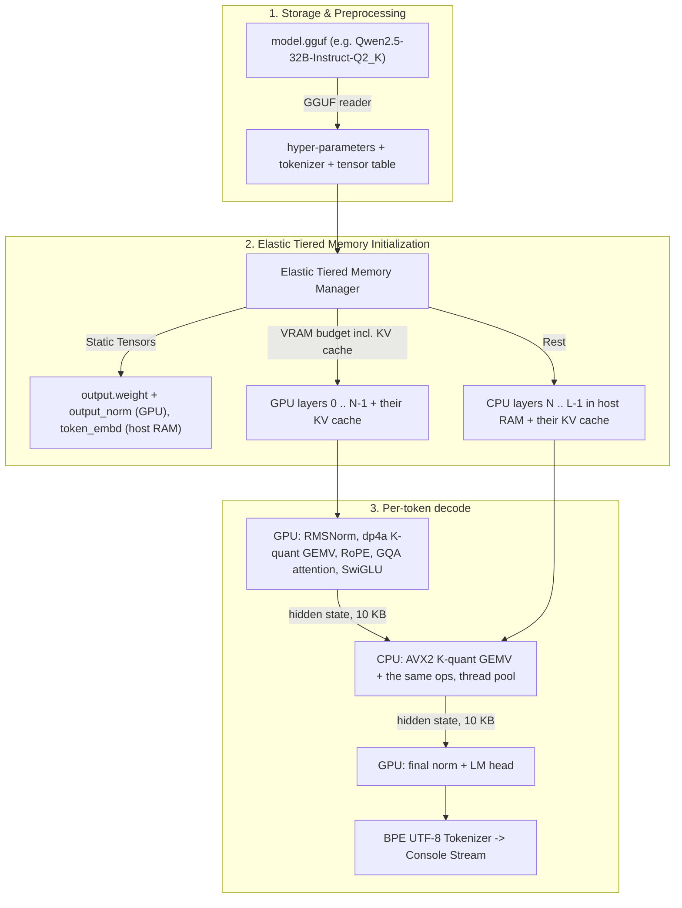

<div align="center">
  
# 🚀 FRIDAY Engine 2.0 (V32)
### **Bare-Metal C++17 & Native CUDA LLM Inference Engine**
*Elastic Tiered Memory • Zero External Runtime Dependencies • Real-Time Token Streaming*

[](https://en.wikipedia.org/wiki/C%2B%2B17)
[](https://developer.nvidia.com/cuda-toolkit)
[](https://microsoft.com)
[](https://huggingface.co/Qwen/Qwen2.5-14B-Instruct)
[](LICENSE)
[](docs/ROADMAP.md)

<p align="center">
  <b>Run 14-billion-parameter LLMs locally on a consumer GPU within a 6 GB VRAM budget.</b><br>
  No PyTorch. No ONNX Runtime. No llama.cpp. No vLLM. Plain C++17 and CUDA (plus the header-only nlohmann/json).
</p>

</div>

---

## 📖 Overview

**FRIDAY Engine 2.0** is an experimental inference engine written from scratch in **C++17** and **NVIDIA CUDA**.

> **Project status:** experimental. The v1 plan (CUDA + ARM64 CPU backends, GGUF loading, chat, persistent memory, OpenAI-compatible API) is in [docs/ROADMAP.md](docs/ROADMAP.md); decisions are recorded in [docs/decisions/](docs/decisions/).

Modern cloud and edge LLM deployments are heavily constrained by high memory demands and runtime overhead. Running a **14-Billion parameter** model (like `Qwen2.5-14B-Instruct`) typically requires 10 GB – 16 GB of dedicated GPU VRAM. 

FRIDAY Engine splits a model between the GPU and the CPU (**Elastic Tiered Memory**): as many transformer layers as fit are kept in VRAM and computed with custom CUDA kernels; the remaining layers stay in host RAM and are computed on the CPU with SIMD kernels, so no weights cross PCIe during generation. On an RTX 3060 12 GB + Ryzen 5 5600X it decodes Qwen2.5-32B-Instruct Q2_K at ~10.7 tok/s and 8B models at ~47-50 tok/s, about 90% of llama.cpp b12189 at its best settings; see [Benchmarks](#-benchmarks).

---

## ⚡ Key Innovations & Architectural Breakthroughs



### 1. 🧠 Elastic Tiered Memory (ETM) Architecture
- **Dynamic VRAM Sizing (`--vram <gb>`):** The engine probes total and available physical VRAM dynamically (or obeys a user-specified limit such as `--vram 6.0`).
- **GPU layers first:** the LM head and output norm stay in VRAM; then as many transformer layers as fit, each charged with its share of the GPU KV cache (`--ctx`). The embedding table lives in host RAM (one row is uploaded per token).
- **Backends:** `friday::Engine` (engine.h) is the only API the CLI and tests use; it hides device memory. The CUDA backend (`Transformer`) runs the GPU layers and hands the rest to the CPU backend (`CpuLayerRunner`), which can also run a whole model, embedding and LM head included, when there is no GPU or with `--backend cpu`.
- **CPU layers:** the remaining layers are loaded into host RAM at startup and computed on the CPU (`--threads`, default 2/3 of the logical CPUs). Only the 10 KB hidden state crosses PCIe, twice per token. No disk I/O occurs during generation.
- **Why not stream weights over PCIe?** Measured on the dev box: PCIe 3.0 x16 moves ~13 GB/s, the CPU reads host RAM at ~38 GB/s, so computing a non-resident layer on the CPU (~6 ms) beats copying it to the GPU every token (~13 ms). The previous streaming mode (DMA slots, two CUDA streams) is still available with `FRIDAY_OFFLOAD=stream`.

### 2. ⚡ Native Custom CUDA GEMV Kernels
FRIDAY does not link against external BLAS or inference libraries. Every operation is hand-written:
- **K-quant GEMV with int8 activations (`Q2_K`, `Q3_K`, `Q4_K`):** the activation is quantized to int8 in blocks of 32 (as in llama.cpp's mmvq path) and weights are multiplied with `__dp4a`; 80–90% of the RTX 3060's memory bandwidth on the large matrices. `FRIDAY_GEMV_FP32=1` selects the older fp32-activation kernels.
- **CPU K-quant GEMV (AVX2/FMA/F16C):** same int8 activation format, `maddubs`-based dot products, runtime CPU check with a scalar fallback; ~34 GB/s on a Ryzen 5 5600X.
- **`Q6_K` GEMV Kernel:** warp-per-row, coalesced (LM head).
- **`Q4_0` / `Q4_1` / `Q8_0` GEMV Kernels:** legacy formats.
- **Fast RMSNorm:** Vectorized FP32/FP16 normalization with warp-shuffle reduction.
- **Custom RoPE (Rotary Position Embeddings):** Direct device rotation supporting rotary base frequencies up to $1,000,000$ (as required by modern Qwen2.5 models).
- **SwiGLU Non-Linearity:** Parallel fused kernel computing `silu(gate) * up` in place.

### 3. 🛡️ Numerically Stable FP32-Safe Softmax
> Decode attention runs where its layer runs: a CUDA kernel over the fp16 GPU KV cache for GPU layers, and a multithreaded CPU implementation (same math and fp16 rounding points) for CPU layers.

Under Grouped-Query Attention (GQA) with scaling factors ($1 / \sqrt{d_k}$), standard FP16 softmax accumulators often experience exponent overflow or catastrophic cancellation, producing `NaN` or infinite values.
FRIDAY Engine implements a **two-pass online Safe Softmax**:
1. Finds the maximum attention score per head across sequence positions.
2. Subtracts the maximum before exponentiation and computes intermediate exponentials and sum in **FP32 registers**, safely casting back to `half` for final score-value projection.

### 4. 🔤 Native Fast C++ BPE Tokenizer
- Clean, standalone C++ implementation of Byte Pair Encoding (BPE).
- Full UTF-8 byte-to-unicode remapping (decoding GPT-2 / Qwen artifacts like `Ġ` $\to$ space, `Ċ` $\to$ newline, `ĉ` $\to$ tab, `\xe2\x96\x81`).
- Native ChatML support (`<|im_start|>system...<|im_end|><|im_start|>user...<|im_end|><|im_start|>assistant`).
- **Real-Time Token Streaming:** Tokens appear immediately on the console (`std::flush`) with negligible latency as they are decoded.

### 5. 📦 Direct GGUF Loading
The engine reads `.gguf` files directly: hyper-parameters and the tokenizer come from the GGUF metadata, and each layer's tensors are read into one packed buffer (GGUF does not guarantee that a layer's tensors are contiguous). The C++ reader is bounds-checked and rejects truncated or malformed files. The older `converter.py` workflow (4 KB-aligned `friday_aligned_int4.bin` + `tensor_map.json` + `model_params.json` + `tokenizer_config.json`) still works but is **deprecated** and will be removed in a later release.

---

## 🏗️ Repository Structure

```
friday-inference-engine/
├── CMakeLists.txt              # Unified CMake build configuration (MSVC + NVCC)
├── main.cpp                    # Application entry point, CLI parser & streaming loop
├── transformer.h               # Transformer engine & Elastic Tiered Memory definitions
├── transformer.cpp             # Forward pass, GQA, SwiGLU, and layer dispatching
├── io_manager.h                # Asynchronous I/O manager interface
├── io_manager.cpp              # Sector-aligned asynchronous file operations
├── memory_manager.h            # Host and Device memory allocator
├── memory_manager.cpp          # Pinned host memory & device buffer management
├── kernel_dispatcher.h         # Quantization type dispatcher
├── kernel_dispatcher.cpp       # Runtime GEMV kernel selector
├── cuda_math_kernels.h         # CUDA kernel headers (Q4_0, Q4_1, Q6_K, Q8_0)
├── cuda_math_kernels.cu        # High-performance CUDA GEMV kernels & reductions
├── int4_kernel.cu              # Dedicated INT4 GEMV & RMSNorm kernels
├── tokenizer.h                 # BPE Tokenizer interface
├── tokenizer.cpp               # BPE encoding, ChatML parser, and UTF-8 mapper
├── friday_types.h              # Platform I/O types and alignment constants
├── gguf_file.h/.cpp            # Bounds-checked GGUF reader (metadata + tensor table)
├── model_config.h/.cpp         # Hyper-parameters from GGUF metadata
├── converter.py                # Deprecated: GGUF -> 4KB aligned .bin + tensor_map.json
├── include/
│   └── nlohmann/
│       └── json.hpp            # Header-only JSON library for parameter mapping
├── docs/
│   ├── ROADMAP.md              # Milestones and version scope
│   └── decisions/              # Architecture decision records (ADRs)
├── .gitignore                  # Strict ignore rules for large weights and build artifacts
├── LICENSE                     # Apache License 2.0
└── README.md                   # Technical documentation
```

---

## 🚀 Quick Start Guide

### Prerequisites
- **Operating System:** Windows 10 / 11 (Linux builds are not yet tested)
- **Compiler:** Microsoft Visual Studio 2022 (MSVC C++17)
- **CUDA Toolkit:** NVIDIA CUDA Toolkit 12.0 or higher
- **Build System:** CMake 3.18 or higher
- **GPU:** NVIDIA GPU. The build targets `sm_86` (RTX 30-series) by default; other architectures need `CMAKE_CUDA_ARCHITECTURES` changed and are untested.

### Step 1: Clone the Repository
```bash
git clone https://github.com/onurtamer/friday-inference-engine.git
cd friday-inference-engine
```

### Step 2: Download a Model
Download a GGUF file of a supported model. No conversion step is needed.

| Architecture | Tested model (golden test vs. llama.cpp) | Weight types (GPU and CPU kernels) |
| :--- | :--- | :--- |
| `qwen2` (Qwen2.5) | Qwen2.5-32B-Instruct Q2_K | Q2_K, Q3_K, Q4_K, Q5_K, Q6_K, Q8_0 |
| `llama` (Llama 3.x) | Meta-Llama-3.1-8B-Instruct Q4_K_M | (same) |
| `qwen3` (Qwen3) | Qwen3-8B Q4_K_M | (same) |

Requirements today: head dimension 128, BPE (`gpt2`) tokenizer with the `qwen2` or `llama-bpe` pre-tokenizer. Other architectures are rejected with a message. Mistral (SentencePiece tokenizer) is planned after roadmap R3.

### Step 3: Build the Engine
Build the project in `Release` mode using CMake:
```bash
cmake -B build -A x64
cmake --build build --config Release
```
*The compiled binary will be located at `build/Release/FridayEngine.exe`.*

CPU-only build (no CUDA toolkit needed; runs the whole model on the CPU):
```bash
cmake -B build-cpu -A x64 -DFRIDAY_ENABLE_CUDA=OFF
cmake --build build-cpu --config Release
```
`FridayEngine --info` prints what the machine offers (CPU features, RAM, CUDA devices with VRAM and PCIe link) and which backend will be used.

### Step 4: Run Inference
Launch the engine with your preferred VRAM allocation:
```bash
# Auto-detect available VRAM:
.\build\Release\FridayEngine.exe Qwen2.5-32B-Instruct-Q2_K.gguf

# Or cap the VRAM budget (e.g., 6.0 GB):
.\build\Release\FridayEngine.exe --vram 6.0 Qwen2.5-32B-Instruct-Q2_K.gguf
```

### Step 5: Run the Tests
```bash
cmake -B build -A x64 -DFRIDAY_MODEL_DIR=<dir with Qwen2.5-32B-Instruct-Q2_K.gguf>
cmake --build build --config Release
ctest --test-dir build -C Release -L unit    # CPU only, < 10 s
ctest --test-dir build -C Release -L gpu     # GPU kernels vs. gguf reference (needs Python gguf + numpy)
ctest --test-dir build -C Release -L model   # end-to-end regression snapshot, ~1 min
```
Tests labelled `known-failing` document open defects and are expected to fail until fixed. The `model` label also includes CPU-only tokenizer tests against reference Qwen2 token ids (tokenizer read from the GGUF). Tests for the deprecated `.bin` path run only if `friday_aligned_int4.bin`, `tensor_map.json` and `tokenizer_config.json` are also present.

---

## ⚙️ Command-Line Interface (CLI)

| Option | Argument | Description | Default |
| :--- | :--- | :--- | :--- |
| `--vram` | `<float>` | Maximum GPU VRAM to allocate for weights and buffers (in GB). | `0.0` (Auto-detect free VRAM) |
| `--ctx` | `<int>` | KV cache capacity in tokens (prompt + generated). GPU layers keep it in VRAM (fp16, 4 KiB per token per layer for Qwen2.5-32B), CPU layers in host RAM. | `2048` |
| `--threads` | `<int>` | CPU threads for the CPU-computed layers. | `0` (2/3 of the logical CPUs) |
| `--backend` | `auto` / `cuda` / `cpu` | `cpu` runs every layer, the embedding and the LM head on the CPU. `FRIDAY_BACKEND` sets the same for tools such as the golden test. | `auto` (CUDA if a device is present) |
| `--kv` | `auto` / `f16` / `q8` | GPU KV cache format. `q8` (int8 + fp16 scale per 32 values) halves its VRAM, which can fit more layers on the GPU, and changes numerics slightly. `auto` uses `f16` when the whole model fits on the GPU with it, otherwise `q8` if that fits more layers. `FRIDAY_KV` sets the same. | `auto` |
| `--info` | | Capability report, then exit. | |

A/B switches for development (environment variables): `FRIDAY_FUSED=0` (unfused GPU layer kernels), `FRIDAY_GRAPH=0` (no CUDA Graph), `FRIDAY_ATTN_SPLIT=0` (single-block attention), `FRIDAY_GEMV_FP32=1` (fp32-activation GEMV), `FRIDAY_OFFLOAD=stream` (stream non-resident layers over PCIe).
| `<model_path>`| `<string>` | Path to the `.gguf` model file, or the id of a registered model (a converted `.bin` is still accepted, deprecated). | `friday_aligned_int4.bin` |

### Model registry
```bash
FridayEngine models add Qwen2.5-32B-Instruct-Q2_K.gguf qwen2.5-32b-q2k   # hashes the file once (~40 s for 12 GB)
FridayEngine models list                                                 # id, architecture, quant, size, parameters, license, SHA-256
FridayEngine models verify qwen2.5-32b-q2k                               # re-hash and compare
FridayEngine models remove qwen2.5-32b-q2k                               # forgets the entry, keeps the file
FridayEngine qwen2.5-32b-q2k                                             # run by id
```
The registry is a JSON file: `%APPDATA%\friday\models.json` on Windows, `~/.config/friday/models.json` on Linux (override with `FRIDAY_REGISTRY`). The license is taken from the GGUF `general.license` field when present; check the model card in any case.

---

## 📊 Benchmarks

Measured by the author on one machine: **RTX 3060 12 GB (PCIe 3.0 x16), Ryzen 5 5600X, 16 GB DDR4, Windows 11**, model **Qwen2.5-32B-Instruct Q2_K** (64 layers), the golden-test prompt (~50 tokens prompt, 32 generated, greedy), full VRAM, `--ctx 2048`. Median of 3 runs; desktop applications were open. A controlled benchmark tool (N repeats, median/p95, GPU clocks, free RAM) is planned (roadmap R5).

Measured 2026-11-09 with `friday-bench` and `tools/bench/llama_cpp_bench.py` (quiet machine, same prompt tokens, greedy, 512-token prompt + 128 generated, median of 5 runs; llama.cpp at its fastest `-ngl` for the model):

| Model | FRIDAY decode | llama.cpp b12189 decode | FRIDAY / llama.cpp |
| :--- | ---: | ---: | ---: |
| Meta-Llama-3.1-8B-Instruct Q4_K_M (all on GPU) | 50.0 tok/s | 55.4 tok/s | 90% |
| Qwen3-8B Q4_K_M (all on GPU) | 47.4 tok/s | 53.2 tok/s | 89% |
| Qwen2.5-32B-Instruct Q2_K (GPU + CPU) | 10.7 tok/s (58/64 on GPU) | 11.7 tok/s (`-ngl 58`) | 92% |

**llama.cpp is currently faster on this machine.** Earlier README figures that showed FRIDAY ahead on the 32B model compared against llama.cpp at `-ngl 50`, which is well below its best setting here (`-ngl` 50: 8.3, 56: 11.0, 58: 11.7, 60: 10.2 tok/s); they were wrong and are withdrawn. FRIDAY's 32B results also vary more between runs (9.2-12.2 tok/s in interleaved runs, llama.cpp 13.2 stable, short context). Prefill is far behind: FRIDAY ~50 tok/s (8B) and ~11 tok/s (32B), one token at a time; llama.cpp ~1800-1950 and ~300 tok/s (batched). Raw results: [docs/bench/2026-11-09-rtx3060](docs/bench/2026-11-09-rtx3060).

Method, tools (`friday-bench`, llama.cpp comparison script) and estimates for other hardware: [docs/BENCHMARKS.md](docs/BENCHMARKS.md). Prefill: FRIDAY ~10 tok/s on the 32B model (token by token), llama.cpp ~70 tok/s.

- Prefill in FRIDAY is still token by token (batched prefill with tensor-core GEMM is on the roadmap), so llama.cpp is far ahead there.
- Outputs are checked against llama.cpp on every change: 32/32 identical greedy tokens, max top-1 log-prob difference 0.27 (`ctest -L model`).

---

## 🎯 Design Philosophy

> *"High-performance systems programming is not about adding more abstractions; it is about eliminating unnecessary ones until only compute and memory remain."*

FRIDAY Engine explores how far 14-billion-parameter models can be pushed on modest consumer hardware when framework overhead is removed.

---

## 📄 License
This project is licensed under the [Apache License 2.0](LICENSE).

## 🙏 Acknowledgements
AI-assisted tooling was used during development.

